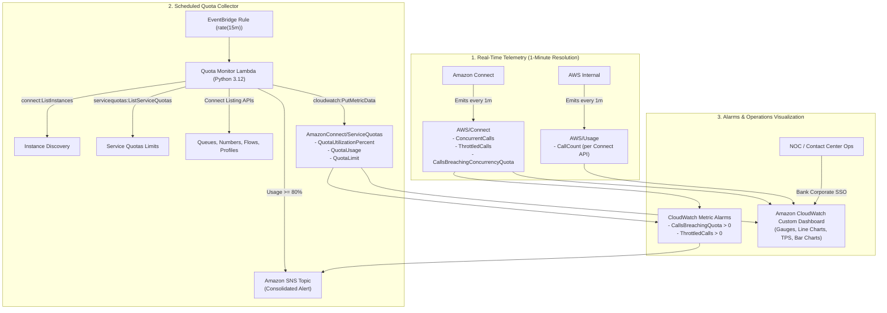

# Amazon Connect Service Quota Monitor

A simplified, bank-grade operational monitoring and alerting solution for **Amazon Connect Service Quotas**. 

Designed specifically for enterprise and financial services AWS accounts where hosting static web dashboards via S3, CloudFront, Lambda@Edge, or Cognito is restricted by security policies.

---

## 🏛️ Why This Architecture?

| Concern | Original AWS Sample Repo (sample-amazon-connect-...) | This Repository (Bank-Compliant Architecture) |
|---|---|---|
| **Dashboard Hosting** | Private S3 + CloudFront + Lambda@Edge + Cognito Hosted UI | **Native Amazon CloudWatch Dashboard** inside AWS Console |
| **Authentication & IAM** | Custom Cognito User Pool & Edge Auth in `us-east-1` | **Existing Corporate SSO & IAM Roles** (AWS IAM Identity Center, Okta, Azure AD) |
| **Data Freshness** | 1-hour batch polling | **1-minute real-time** for active calls, dropped calls, and API rate limits |
| **Alert Latency** | Hourly scan | **Immediate (sub-minute)** CloudWatch Metric Alarms on dropped/throttled calls |
| **Deployment Complexity** | Two-phase Terraform applies + custom JS/HTML builders | **Single-command `terraform apply`** with zero external dependencies |

---

## 📐 Architecture & Data Flow



---

---

## 📊 Monitored Quotas & Covered Services

The monitor covers **all quotas across Amazon Connect and its related service ecosystem**, combining a pre-mapped catalog of **112 baseline quotas** with **dynamic Service Quotas discovery** across all Connect-family services.

### Supported Services

| Service | Code | Quotas Monitored |
|---|---|---|
| **Amazon Connect Core** | `connect` | Telephony concurrency, phone numbers, contact flows, modules, users, security profiles, hierarchy groups, queues, routing profiles, quick connects, agent statuses, prompts, predefined attributes |
| **Connect API Rate Limits** | `connect` | 40+ high-frequency APIs monitored in real-time TPS (`GetContactAttributes`, `UpdateContactAttributes`, `StartOutboundVoiceContact`, `SearchContacts`, `GetMetricDataV2`, etc.) |
| **Amazon Connect Cases** | `connectcases` | Case domains, fields, templates, layouts, related items, and API rate limits |
| **Outbound Campaigns** | `connectcampaigns` | Active campaigns, dial requests, and campaign concurrency limits |
| **Connect Participant** | `connect-participant` | Real-time participant chat connection rates, streaming, and messaging APIs |
| **Customer Profiles** | `profile` | Profile domains, object types, search queries, and integration associations |
| **Amazon Q in Connect (Wisdom)** | `wisdom` | Knowledge bases, assistant associations, content uploads, and query rates |
| **Amazon Connect Voice ID** | `voiceid` | Voice ID domains, speaker enrollments, watchlist evaluations, and API limits |
| **Amazon AppIntegrations** | `appintegrations` | Event integrations, data integrations, applications, and file transfer quotas |

### Quota Categories in Catalog (112 Baseline Definitions)

- **`CORE_CONNECT` (13):** Instance count, users, security profiles, hierarchy groups, phone numbers, contact flows, flow modules, predefined attributes, external voice transfer connectors.
- **`CONTACT_HANDLING` (6):** Concurrent voice calls, active chats, concurrent tasks, concurrent emails, campaign calls.
- **`ROUTING_QUEUES` (6):** Queues, routing profiles, quick connects, agent statuses, queues per routing profile.
- **`API_RATE_LIMITS` (40):** Per-second Transaction Per Second (TPS) quotas across all Connect APIs derived from `AWS/Usage:CallCount / 60`.
- **`FORECASTING_CAPACITY` (28):** Forecasting groups, schedules, agents per schedule, capacity planning.
- **`INTEGRATIONS` (11):** Lambda function associations, Lex bots, application integrations, event integrations.
- **`CONTACT_LENS` (5):** Post-call analytics jobs, chat analytics jobs, automated interaction analytics.
- **`REPORTING` (3):** Saved reports, scheduled reports, external recording sessions.
- **Dynamic Layer 1:** Any new or unlisted quota added to the Connect service family by AWS is automatically discovered at runtime from Service Quotas and tracked.

---

## 🖥️ CloudWatch Dashboard Layout

The dashboard is generated automatically by Terraform and contains:

1. **Header & Status Banner:** Operational instructions, region, and warning thresholds.
2. **Alarm Status Tiles:** Live status widgets for critical telephony breaches, API throttling, and high quota utilization.
3. **Speedometer Gauge Dial:** Displays highest current quota utilization percentage with color-coded safety, warning (80%), and breach (100%) zones.
4. **Active Concurrent Calls (1-Minute Line Chart):** Real-time voice concurrency curve plotted against dynamic warning and hard limit threshold annotations.
5. **API Rate Limits (TPS):** Converts 1-minute `CallCount` into live Transactions Per Second (TPS) across high-volume Connect APIs using CloudWatch Metric Math.
6. **Resource Capacity Bar Chart:** Visualizes allocations for Phone Numbers, Contact Flows, Queues, and Routing Profiles against ceilings.
7. **Comprehensive Quota Headroom Table:** Tabular summary of all monitored items, current counts, and quota ceilings.

---

## 📁 Repository Structure

```text
connect-service-qouta-monitor/
├── src/
│   ├── discovery.py             # Discovers Connect instances & active Service Quotas
│   ├── collector.py             # Collects API counts, CloudWatch metrics, & API TPS
│   ├── publisher.py             # Pushes custom CloudWatch metrics & consolidated alerts
│   ├── lambda_function.py       # Main Lambda handler entrypoint
│   └── quota_definitions.json   # Base catalog of Amazon Connect quotas
├── terraform/
│   ├── versions.tf              # Required Terraform & provider versions
│   ├── providers.tf             # AWS provider configuration
│   ├── variables.tf             # Input variables & validation rules
│   ├── sns.tf                   # Encrypted SNS topic for alerts
│   ├── iam.tf                   # Least-privilege IAM execution role
│   ├── lambda.tf                # Lambda packaging, logs, and function configuration
│   ├── events.tf                # EventBridge scheduled trigger
│   ├── alarms.tf                # Real-time CloudWatch Metric Alarms
│   ├── cloudwatch_dashboard.tf  # Native CloudWatch Dashboard definition
│   ├── outputs.tf               # Resource ARNs and direct console dashboard link
│   └── terraform.tfvars.example # Example variable values
├── tests/                       # Unit test suite (python unittest / pytest)
│   ├── test_discovery.py
│   ├── test_collector.py
│   ├── test_publisher.py
│   └── test_lambda_function.py
├── requirements.txt             # Runtime Python dependencies
├── requirements-dev.txt         # Development & testing dependencies
├── .gitignore
└── README.md
```

---

## 🚀 Deployment Guide

### Prerequisites
- AWS CLI configured with appropriate credentials: `aws sts get-caller-identity`
- Terraform `>= 1.5.0`
- Python `>= 3.10`

### Step 1: Clone and Configure

```bash
cd connect-service-qouta-monitor/terraform

# Create your custom tfvars file
cp terraform.tfvars.example terraform.tfvars
```

Edit `terraform.tfvars`:
```hcl
aws_region           = "us-east-1"  # Target region where your Connect instance is deployed
environment          = "prod"
threshold_percentage = 80
schedule_expression  = "rate(15 minutes)"

# Target Amazon Connect Instance ID (UUID) or ARN:
connect_instance_id  = "xxxxxxxx-xxxx-xxxx-xxxx-xxxxxxxxxxxx"
```

### Step 2: Initialize & Deploy

```bash
terraform init
terraform plan
terraform apply
```

Upon completion, Terraform will output:
- `cloudwatch_dashboard_url`: Direct link to open the dashboard in the AWS Console.
- `sns_topic_arn`: ARN of the created notification topic.
- `lambda_function_arn`: ARN of the monitor Lambda.

### Step 3: Configure SNS Subscriptions (Console)

The Terraform configuration creates a managed, encrypted SNS topic (`connect-quota-monitor-<env>-alerts`). 

To subscribe your team:
1. Open the **Amazon SNS Console** in your AWS account.
2. Under **Topics**, click `connect-quota-monitor-prod-alerts`.
3. Click **Create subscription**.
4. Choose your protocol (e.g., **Email**, **SMS**, or **HTTPS** for Slack/MS Teams webhook).
5. Enter the target endpoint and click **Create subscription**.
6. *(For Email)* Confirm the subscription via the verification email sent by AWS.

---

## 🧪 Running Unit Tests Locally

The test suite runs using Python's standard `unittest` runner without requiring AWS credentials:

```bash
python -m unittest discover tests
```

Expected output:
```text
Ran 8 tests in 0.009s
OK
```

---

## 🔒 Security & Banking Compliance
- **Zero Web Perimeter:** No S3 buckets configured for website hosting, no CloudFront distributions, no public API endpoints.
- **Data Protection:** SNS topic encrypted at rest with AWS KMS (`alias/aws/sns`).
- **Least Privilege:** IAM policies explicitly scope permissions to read-only Connect and Service Quota operations.
- **Role-Based Access Control:** Dashboard access is protected by native AWS Console IAM / Corporate SSO identity federation.

